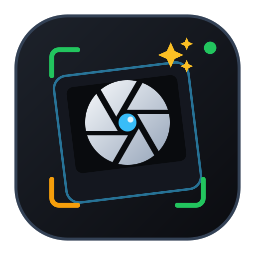
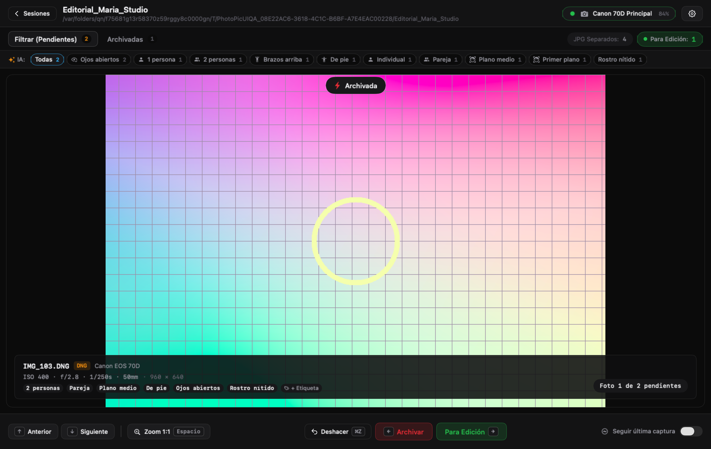
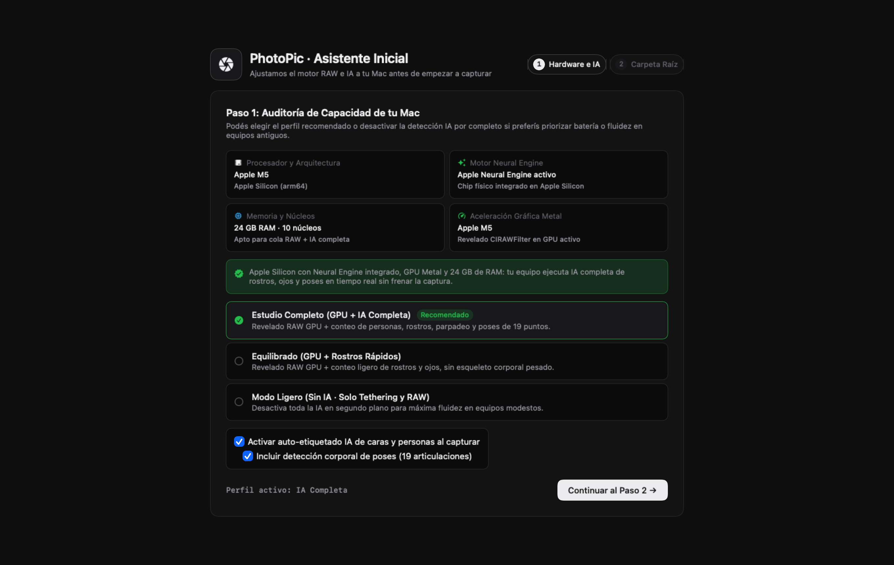
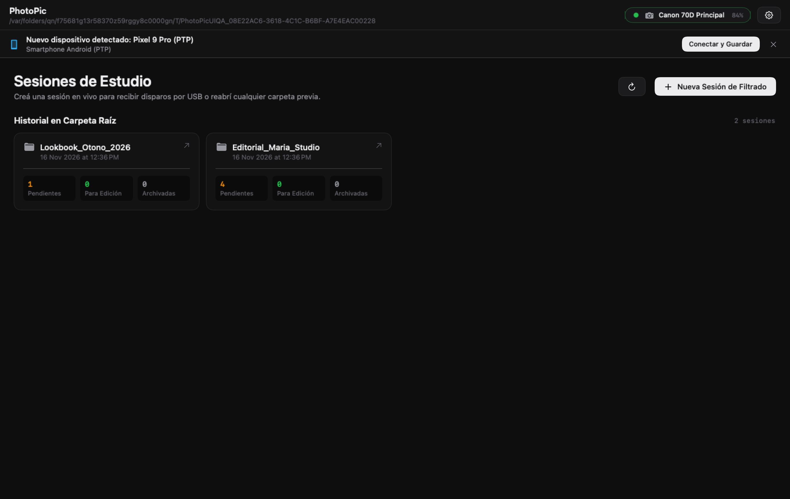
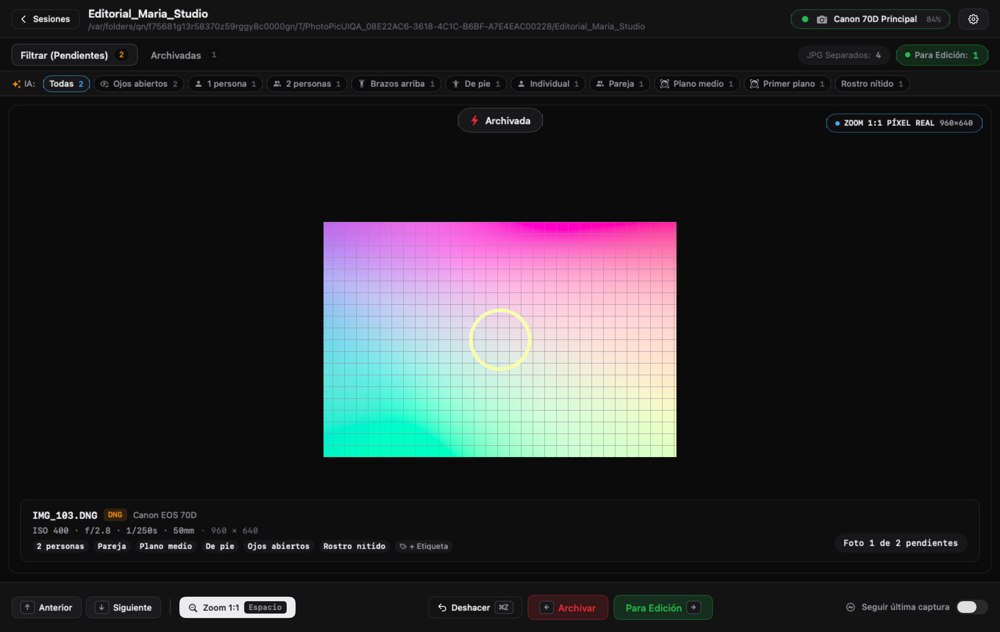
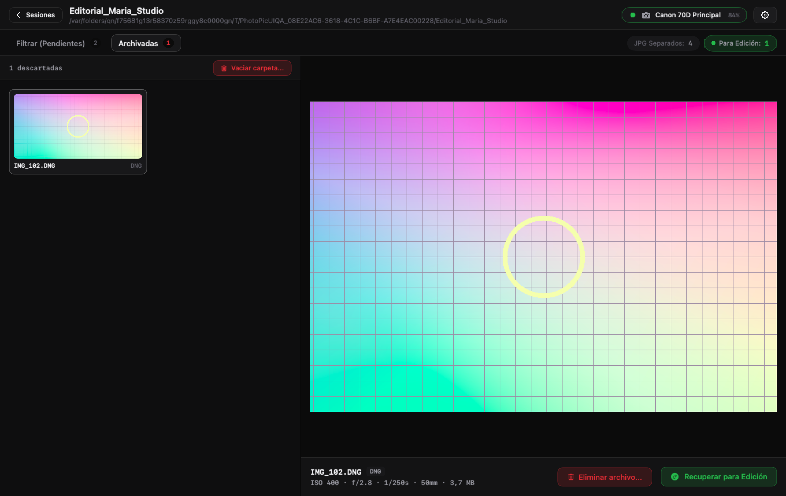
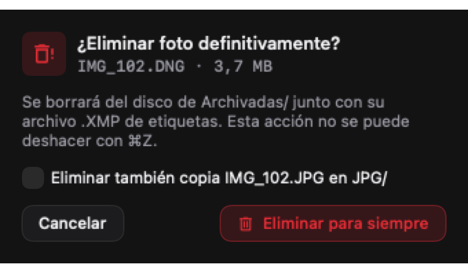
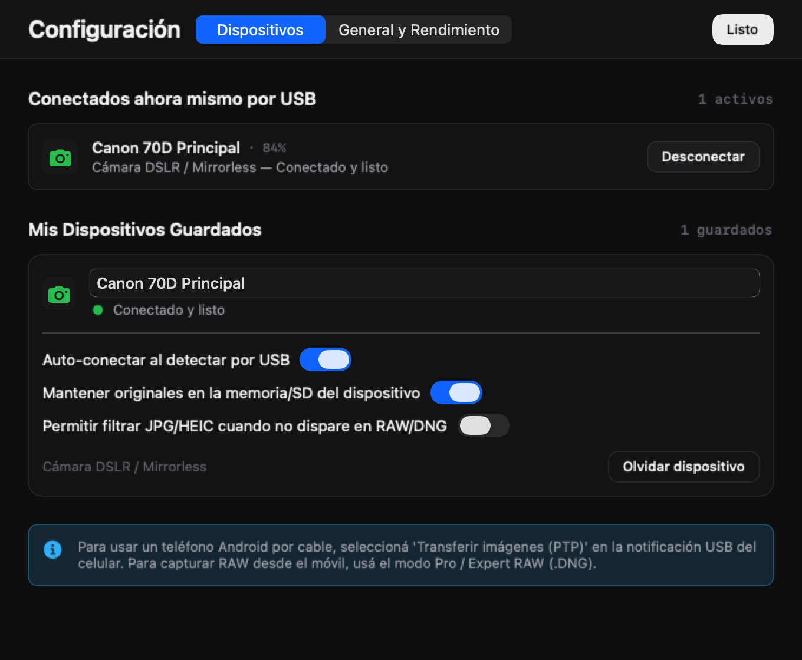
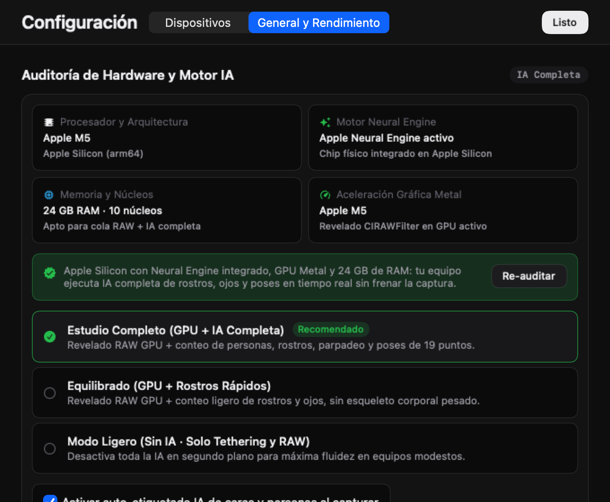

<p align="center">
  
</p>

<h1 align="center">PhotoPic</h1>

<p align="center">
  <strong>Estudio nativo 100% offline para captura tethered multi-dispositivo (DSLR, Mirrorless, Android y iPhone), culling RAW en tiempo real y auto-etiquetado IA de caras, poses y personas.</strong>
</p>

<p align="center">
  
  
  
  
  
</p>

---

## ¿Qué es PhotoPic?

**PhotoPic** convierte tu Mac o PC con Windows en una estación de tethering y clasificación ultrarrápida (*"Tinder de fotos"*). Mientras el fotógrafo dispara con una cámara dedicada (**Canon EOS, Sony Alpha, Nikon Z, Fujifilm...**) o con un **smartphone por cable USB / Thunderbolt 4**, las fotos entran en tiempo real, la IA offline etiqueta automáticamente cuántas personas hay, sus poses y si tienen los ojos abiertos/cerrados, y vos decidís foto a foto moviendo los archivos físicos en disco (`RAW/` → `Para_Edicion/` o `Archivadas/`).

- **Cero servidores web ni `localhost`:** App 100% nativa en **Swift 6 / SwiftUI / Metal / Vision** para macOS y **Qt 6 (`PySide6`) / LibRaw / MediaPipe** para Windows.
- **Revelado de sensor puro:** En RAW está prohibido usar miniaturas JPG incrustadas; siempre revela desde el sensor (`CIRAWFilter` GPU Metal en Mac, `LibRaw` en Windows) para validar nitidez real al **Zoom 1:1 (100% píxel real)**.
- **Escudo Anti-Galería Vieja:** Al conectar un celular con miles de fotos o una SD llena, indexa silenciosamente los archivos previos y **jamás descarga fotos antiguas** — solo captura disparos hechos después de conectar el cable.

---

## Capturas Reales de la Interfaz (Darkroom UI)

<p align="center">
  
</p>

<details>
<summary>Ver todas las pantallas (Asistente Inicial con Auditor de Hardware, Sesiones, Zoom 1:1, Archivadas con Borrado, Popover y Dispositivos)</summary>

| Pantalla | Vista |
| :--- | :--- |
| **Asistente Inicial · Paso 1 (Auditoría de Hardware e IA)** |  |
| **Inicio / Sesiones** |  |
| **Zoom 1:1 Píxel Real** |  |
| **Archivadas (Recuperar o Eliminar Definitivamente)** |  |
| **Popover de Confirmación al Eliminar** |  |
| **Administrador USB Plug & Play** |  |
| **Ajustes de Rendimiento, Auditoría y Atajos** |  |

</details>

---

## Capacidades Principales

### 1. Multi-Formato Universal (`36` extensiones)
- **25 formatos RAW:** `.DNG` (Android Pro / Expert RAW / ProRAW), `.CR2`, `.CR3`, `.CRW`, `.NEF`, `.NRW`, `.ARW`, `.SRF`, `.SR2`, `.RAF`, `.ORF`, `.ORI`, `.RW2`, `.RAW`, `.PEF`, `.SRW`, `.3FR`, `.FFF`, `.IIQ`, `.RWL`, `.ERF`, `.MOS`, `.MRW`, `.DCR`, `.KDC`.
- **11 formatos comprimidos/móviles:** `.JPG`, `.JPEG`, `.HEIC`, `.HEIF`, `.HIF`, `.AVIF`, `.JXL`, `.WEBP`, `.PNG`, `.TIF`, `.TIFF`.
- **Separación inteligente RAW + JPG:** El maestro RAW entra a `RAW/` y su copia comprimida va automáticamente a `JPG/`. Si un teléfono dispara solo `.JPG`/`.HEIC`, el switch *"Permitir filtrar JPG/HEIC si no hay RAW"* permite usarlo como cámara de apoyo.

### 2. Auditor de Capacidad de Hardware + Asistente Guiado Inicial (y Modo Sin IA)
Desde la primera apertura, **PhotoPic** audita automáticamente tu equipo (`HardwareCapabilityAuditor` en macOS y Windows) antes de pedirte tu Carpeta Raíz:
- **Detección física real:** Inspecciona procesador y arquitectura (Apple Silicon `arm64` con **Apple Neural Engine** físico integrado vs Intel `x86_64` / CPU Windows), núcleos activos, RAM física y GPU Metal.
- **Perfiles configurables desde el inicio (y modificables en Configuración):**
  - **Estudio Completo (GPU + IA Completa):** Apple Silicon / equipos aptos (`>= 12 GB RAM`) con conteo de personas, rostros, parpadeo y poses de cuerpo entero.
  - **Equilibrado (GPU + Rostros Rápidos):** Analiza rostros y ojos sin ejecutar el modelo corporal completo (ideal para Macs Intel o laptops con 8 GB).
  - **Modo Ligero (Sin IA · Solo Tethering y RAW):** Desactiva el análisis Neural Engine / MediaPipe por completo para equipos antiguos o máxima fluidez en estudio.

### 3. Auto-Etiquetado IA 100% Offline (Caras · Ojos · Poses · Personas)
Si elegís mantener activa la IA, el analizador local genera etiquetas al ingresar cada foto y permite filtrar la cola al instante:
- **Conteo de personas:** `Sin personas`, `1 persona` + `Individual`, `2 personas` + `Pareja`, `N personas` + `Grupo` / `Grupo grande`.
- **Detección facial y ojos:** `Primer plano`, `Plano medio`, `Cuerpo entero`, `Ojos abiertos`, alerta `Ojos cerrados` (Eye Aspect Ratio) y `Rostro nítido`.
- **Poses corporales:** `De pie`, `Sentado`, `Brazos arriba`, `Manos en cintura`, `Pose dinámica`.
- **Sidecars `.xmp` compatibles con Lightroom / Capture One:** Cada etiqueta (automática o agregada con `+ Etiqueta`) se escribe en `.photopic_tags.json`, en un archivo `.xmp` que acompaña al RAW al moverse de carpeta y en macOS Finder Tags.

### 4. Organización Automática y Limpieza Definitiva en `Archivadas/`

```text
[Carpeta_Raiz_Global]/
└── [Nombre_De_La_Sesion]/
    ├── .photopic_tags.json   # Caché de etiquetas IA y manuales
    ├── RAW/                  # Cola pendiente (+ sidecars .xmp)
    ├── JPG/                  # Copias .JPG / .HEIC separadas automáticamente
    ├── Para_Edicion/         # Aprobadas (→ / Swipe Derecha)
    └── Archivadas/           # Descartadas (← / Swipe Izquierda: recuperables o eliminables)
```

Dentro de la pestaña **`Archivadas`** podés elegir entre **`Recuperar para Edición`** o liberar espacio en disco mediante **`Eliminar archivo...`** / **`Vaciar carpeta...`**, protegidos con un **Popover nativo de confirmación** que advierte que el archivo y su `.xmp` se borrarán definitivamente (con opción extra para eliminar también la copia `.JPG` asociada en `JPG/`).

---

## Atajos de Estudio

| Atajo / Gesto | Acción |
| :--- | :--- |
| **`→`** o **Swipe Derecha** | Aprobar foto (mueve físicamente de `RAW/` a `Para_Edicion/`) |
| **`←`** o **Swipe Izquierda** | Archivar foto (mueve físicamente de `RAW/` a `Archivadas/`) |
| **`↑` / `↓`** | Navegar libremente por la cola sin mover archivos |
| **`Espacio`** o **Clic sostenido + arrastrar** | Zoom **1:1 píxel real** sobre el sensor revelado para revisar foco crítico |
| **`⌘Z`** *(Mac)* / **`Ctrl+Z`** *(Win)* | Deshacer última clasificación (restaura el RAW y su `.xmp` a `RAW/`) |

---

## Instalación y Compilación

### macOS (`14.0+ Sonoma / Sequoia`)
1. Descargá `PhotoPic-Installer.dmg` desde [Releases](../../releases) y arrastrá **PhotoPic.app** a `/Applications`.
2. Para compilar desde código fuente y correr todas las pruebas:
   ```bash
   swift run PhotoPicVerify
   bash macos/Scripts/package_macos_app.sh
   ```
   *(Genera `dist/PhotoPic.app`, `dist/PhotoPic-Installer.dmg` y actualiza `PhotoPic.xcodeproj`.)*

### Windows (`10 / 11 x64`)
1. Descargá `PhotoPic-Windows-x64.zip` desde [Releases](../../releases), extraelo y ejecutá **`PhotoPic.exe`**.
2. O ejecutá / compilá desde fuente:
   ```powershell
   cd windows
   pip install -r requirements.txt
   python -m unittest discover -s tests -v
   python -m photopic_win.main
   ```

---

## Documentación Detallada (`docs/`)

| Guía | Contenido |
| :--- | :--- |
| [docs/01-formatos-soportados.md](docs/01-formatos-soportados.md) | Matriz completa de 25 formatos RAW y 11 móviles/comprimidos + regla RAW+JPG. |
| [docs/02-ia-etiquetado-automatico.md](docs/02-ia-etiquetado-automatico.md) | Cómo funcionan `Vision.framework` y `MediaPipe` offline, cálculo EAR y sidecars `.xmp`. |
| [docs/03-guia-instalacion-macos.md](docs/03-guia-instalacion-macos.md) | Conexión Thunderbolt 4 / USB-C, Android modo PTP, iPhone y liberación de `PTPCamera`. |
| [docs/04-guia-instalacion-windows.md](docs/04-guia-instalacion-windows.md) | Tethering Windows WPD (MTP/PTP), watchfolders SD y empaquetado `.exe`. |
| [docs/05-arquitectura-modular.md](docs/05-arquitectura-modular.md) | Diagramas de flujo, secuencia anti-galería vieja y mapa de módulos (≤ 300 líneas). |

---

## Créditos, Iconografía y Licencia
- **Iconografía UI y Logo:** Extraída selectivamente mediante [`steven-pictogrammers-icon-lib`](https://github.com/stevensb2003-afk/stvn_created_skills) desde la colección oficial `@mdi/svg` de **Pictogrammers** (`assets/icons/` y `assets/logo.svg`).
- **Licencia:** Distribuido bajo licencia [MIT](LICENSE).
