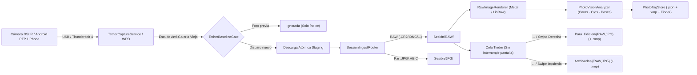
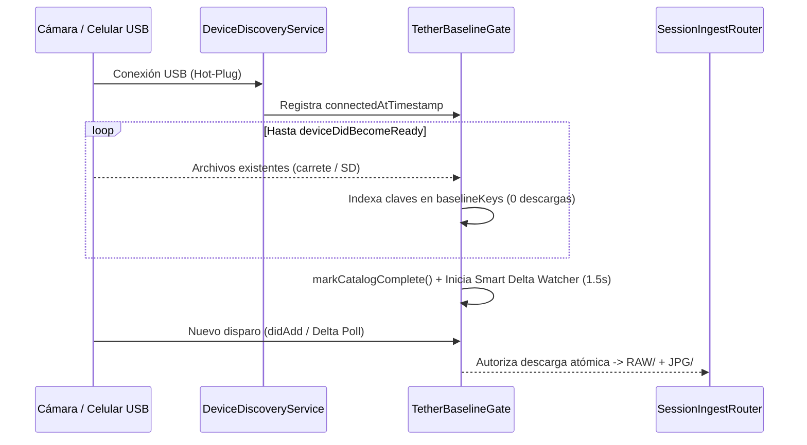

# Arquitectura Modular de PhotoPic

Todo el código fuente de PhotoPic respeta un límite estricto de modularidad (**≤ 300 líneas por archivo**) tanto en Swift (macOS) como en Python (Windows), con una separación estricta entre **Design System**, **Modelos**, **Servicios**, **ViewModels** y **Vistas**.

---

## 1. Flujo en Tiempo Real: Disparo USB → IA → Disco



---

## 2. Secuencia de Protección Anti-Galería Vieja



---

## 3. Estructura de Módulos

```text
PhotoSelect/
├── assets/                          # logo.svg, iconos Pictogrammers SVG, capturas Retina
├── docs/                            # Guías técnicas y manuales de usuario
├── macos/
│   ├── PhotoPic/
│   │   ├── App/                     # PhotoPicApp, AppState
│   │   ├── DesignSystem/            # AppColors, AppTypography, AppSpacing, AppRadius, AppMotion, PictogrammersIcons
│   │   ├── Models/                  # PhotoItem, PhotoExifMetadata, PhotoVisionTags, PhotoSession,
│   │   │                            # KnownDevice, ConnectedDeviceState, PerformancePreferences, HelpGuideCatalog
│   │   ├── Services/                # BookmarkManager, KnownDevicesStore, DeviceDiscoveryService, TetherCaptureService,
│   │   │                            # TetherBaselineGate, FolderWatchTetherService, SessionFileManager (+BucketSync),
│   │   │                            # SessionIngestRouter, SessionArchiveCleaner, RawImageRenderer,
│   │   │                            # ExifMetadataReader, PhotoVisionAnalyzer, PhotoTagStore, HardwareCapabilityAuditor
│   │   ├── ViewModels/              # HomeViewModel, DeviceManagerViewModel, CullingSessionViewModel (+Actions/Rendering/Vision)
│   │   └── Views/                   # Onboarding (+GuidedSetupWizardView), Home, Workspace (+ArchivedDeletePopovers),
│   │                                # Settings, Help (+HelpCenterView), Components (+HardwareAuditSettingsBlock)
│   ├── Resources/                   # Info.plist, PhotoPic.entitlements, AppIcon.icns
│   ├── Scripts/                     # generate_icon.swift, generate_xcodeproj.py, package_macos_app.sh
│   └── Verification/                # SyntheticDNGGenerator, CorePipelineVerification, HardwareAndArchiveDeleteVerification,
│                                    # UISnapshotVerification
└── windows/
    ├── photopic_win/                # main, design_system, hardware_auditor, models, baseline_gate, tag_store,
    │                                # session_manager, ingest_router, archive_cleaner, raw_renderer, vision_autotagger,
    │                                # wpd_tether_service, ui_home, ui_setup_wizard, ui_archived_tab, ui_help_dialog, ui_workspace
    ├── scripts/                     # wpd_bridge.ps1, build_windows_exe.ps1
    └── tests/                       # test_windows_core.py
```
